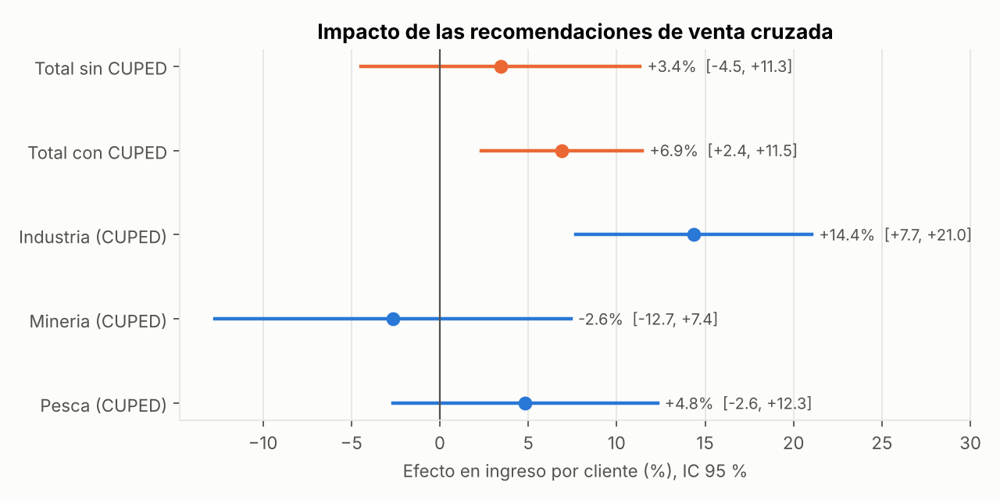
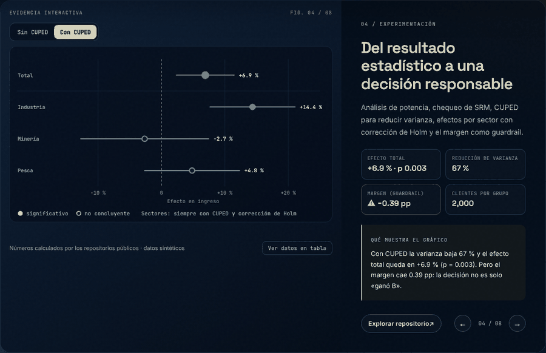
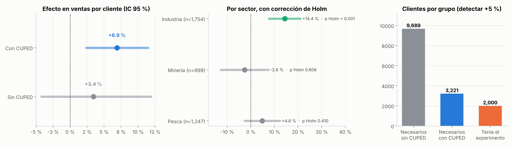

# A/B Test · Recomendaciones de venta cruzada (CUPED, guardrails y heterogeneidad)

> **EN —** Statistical analysis of a randomized experiment testing cross-selling recommendations for B2B sales reps. It covers a power analysis, a sample-ratio-mismatch check, and Welch's t-test with bootstrap CIs. **CUPED** variance reduction recovers an effect the raw test missed, a guardrail metric watches margin, and sector-level effects use a Holm correction. **All data is synthetic.**



## Demo y capturas



> El mismo gráfico es **interactivo** en el [laboratorio de mi portafolio](https://dataross.vercel.app/#laboratorio): mueve los controles y se redibuja con los resultados de este repositorio.



*Efecto con y sin CUPED, por sector y potencia.*

## Pregunta de negocio

¿Mostrar a los vendedores recomendaciones de productos complementarios aumenta el ingreso por cliente,
**sin sacrificar margen**?

**Diseño:** 4,000 clientes asignados al azar (50/50). Métrica principal: ingreso por cliente en 8 semanas.
Guardrail: margen %. Covariable: ingreso de las 8 semanas **previas** (para CUPED).

## Resultados (datos sintéticos)

| Análisis | Efecto en ingreso | IC 95 % | p-valor |
|---|---|---|---|
| Welch, sin ajuste | +3.4 % | [−4.5 %, +11.3 %] | 0.39 |
| **Welch + CUPED** | **+6.9 %** | **[+2.4 %, +11.5 %]** | **0.003** |
| Guardrail: margen | −0.39 pp | [−0.69, −0.08] pp | 0.013 |

**Cómo se lee:**

1. **Con el test simple el experimento no tenía potencia suficiente.** Para detectar +5 % hacían falta unos 9,700 clientes por grupo y había 2,000. "No significativo" **no** significaba "no funciona".
2. **CUPED** usa el ingreso previo de cada cliente para quitar ruido: reduce la varianza en 67 % y baja la muestra necesaria a unos 3,200 por grupo. Con eso el efecto aparece con claridad.
3. **El guardrail encendió una alerta.** El margen baja unos 0.4 pp; las recomendaciones empujan productos de menor margen. La decisión no es solo "lanzar". Hay que comparar el ingreso extra con el margen perdido y ajustar el catálogo recomendado.
4. **Por sector, con corrección de Holm por comparaciones múltiples:** el efecto se concentra en **Industria** (+14 %, p ajustado < 0.001). En Pesca y Minería no se puede distinguir de cero. El +14 % probablemente sobreestima el efecto real (*winner's curse*), así que convendría confirmarlo con un segundo experimento.
5. **Controles de calidad:** sin desbalance de asignación (SRM p = 1.0) y grupos comparables antes del experimento (p = 0.29).

Todos los números están en `reports/resultados.json`.

## Cómo ejecutarlo

```bash
pip install -r requirements.txt
python analysis.py
pytest -q      # valida Welch contra scipy, tamaño de muestra de libro, SRM, CUPED y Holm
```

## Estructura

```
ab-test-cross-selling/
├── analysis.py
├── src/abtest/
│   ├── data.py     # experimento sintético (efecto real conocido)
│   └── stats.py    # potencia, SRM, Welch, bootstrap, CUPED, Holm
├── tests/
├── data/experiment_synthetic.csv
└── reports/
```

*Ventaja de simular:* el efecto verdadero es conocido (en promedio, unos +5 % en ingreso, +8 % en
Industria), así que se puede comprobar si el análisis lo recupera.

---
**Rosy Napuchi** · Business Intelligence & Data Science · [Portafolio](https://dataross.vercel.app/)
